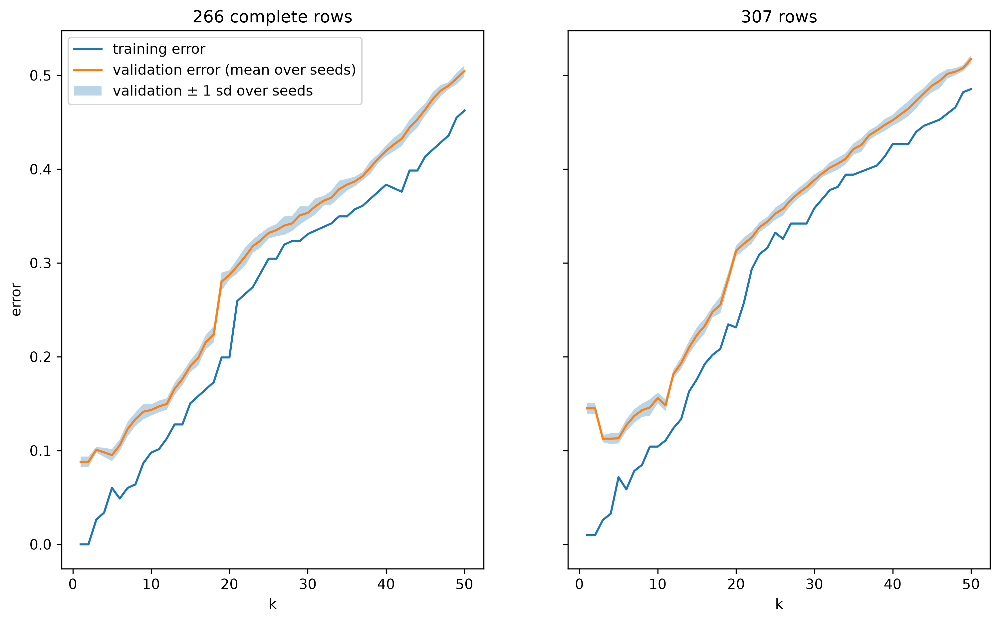
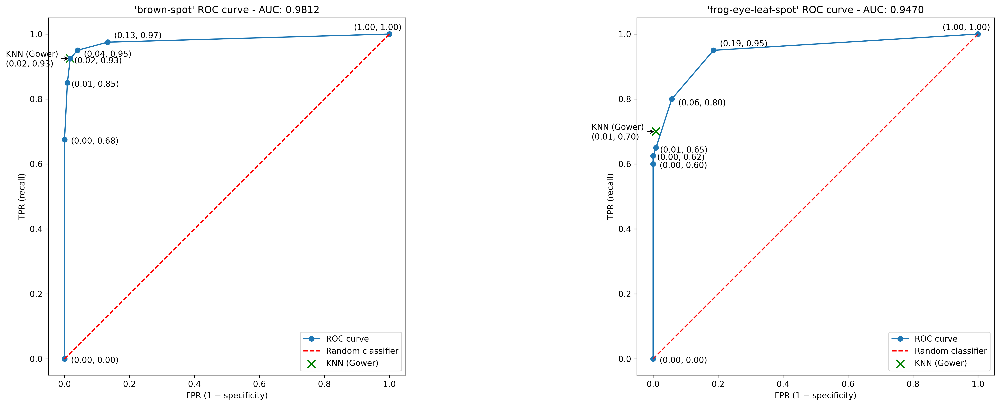

# StatQuest, by hand

Statistics and machine learning from the StatQuest YouTube course by Josh Starmer, implemented step by step in NumPy and pandas on one dataset. scikit-learn is only a dev dependency, used as a reference to check my results.

Work in progress: the latest step is 1.8, bias and variance.

## Dataset

[Soybean (Large)](https://archive.ics.uci.edu/dataset/90/soybean+large) from the UCI Machine Learning Repository: 307 plants, 35 categorical symptoms (some nominal, some ordinal) and 19 diseases, with missing values.

## Progress

| Step | Topic | Code |
| --- | --- | --- |
| 0.2–0.4 | Loading the data, attribute types, missing values | `phase0_foundation/load_soyabeans.py` |
| 0.5 | Linear algebra in NumPy | notes in the journal |
| 1.2 | Distances: Hamming, Euclidean, Manhattan, Gower | `phase1_evaluation/distances.py` |
| 1.3 | k-nearest neighbours against a majority-class baseline | `phase1_evaluation/knn.py`, `baseline.py` |
| 1.4–1.5 | Confusion matrix; precision, recall, specificity, F1; averaging across classes | `phase1_evaluation/metrics.py` |
| 1.6 | ROC curves and AUC | `phase1_evaluation/metrics.py` |
| 1.7 | Train/test, k-fold, stratified k-fold, leave-one-group-out and temporal splits | `phase1_evaluation/splits.py` |
| 1.8 | Bias and variance: training vs. validation error by k | `phase1_evaluation/bias_variance.py` |

## Results so far

Leave-one-out kNN with k = 5 on the 266 plants without missing values (15 diseases), as recorded in step 1.6 of the journal:

| Distance | Accuracy | Macro precision | Macro recall | Macro F1 | Macro AUC |
| --- | --- | --- | --- | --- | --- |
| Gower | 0.8985 | 0.9364 | 0.9233 | 0.9261 | 0.9845 |
| Manhattan | 0.8684 | 0.9213 | 0.8800 | 0.8868 | 0.9900 |
| Hamming | 0.8609 | 0.8992 | 0.8658 | 0.8708 | 0.9910 |
| Euclidean | 0.8383 | 0.8766 | 0.8292 | 0.8374 | 0.9769 |

Always guessing the most common disease scores 0.1504 accuracy on the same plants. Gower leads on every measure except macro AUC; the journal traces that gap to two plants that got no vote for their own class. Gower is also the only one of the four distances that can run on all 307 plants, missing values included.



*Training vs. 10-fold stratified cross-validation error for k = 1 to 50 (step 1.8).*



*ROC curves for brown-spot and frog-eye-leaf-spot, with the kNN operating point marked (step 1.6).*

## The journal

[journal.md](journal.md) records, for each step, the decisions that could have gone the other way and the things that surprised me. Nothing goes there that can be read off the code.

## Running it

Needs Python 3.13 and [uv](https://docs.astral.sh/uv/).

```bash
uv sync
```

Download `soybean-large.data` from the [UCI page](https://archive.ics.uci.edu/dataset/90/soybean+large) and save it as `data/raw/soybean-large.data` (the `data/` folder is not tracked). Then run any step as a module:

```bash
uv run python -m statquest.phase0_foundation.load_soyabeans
uv run python -m statquest.phase1_evaluation.distances
uv run python -m statquest.phase1_evaluation.baseline
uv run python -m statquest.phase1_evaluation.knn
uv run python -m statquest.phase1_evaluation.bias_variance
```

Plots are written to `figures/`.

## Project structure

```
statquest/
├── data/raw/                 # soybean-large.data goes here (not tracked)
├── figures/                  # plots written by the scripts
├── journal.md                # decisions and surprises, step by step
└── src/statquest/
    ├── phase0_foundation/
    │   └── load_soyabeans.py
    └── phase1_evaluation/
        ├── baseline.py
        ├── bias_variance.py
        ├── distances.py
        ├── knn.py
        ├── metrics.py
        └── splits.py
```